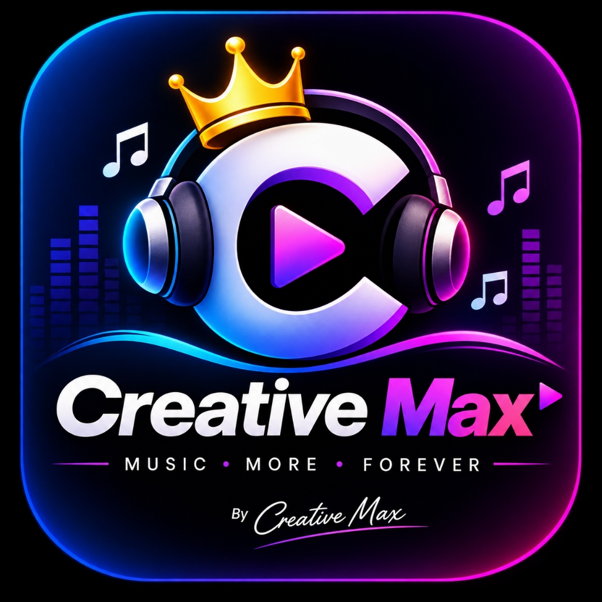

<div align="center">

  

  # 👑 GAAN Unlimited by Creative Max
  ### *True AMOLED Lossless Music Streaming Ecosystem*

  [](https://github.com/MadanMohanPal/GAAN-Creative-Max-/raw/main/gaan/website/public/GAAN_by_Creative_Max.apk)
  [](#-security--virus-free-verification)
  [](https://flutter.dev)
  [](https://nextjs.org)
  [](https://github.com/MadanMohanPal)

  <br />

  <p align="center">
    <b>MUSIC • MORE • FOREVER</b>
    <br />
    <i>Stream, Search, and Download ANY Song Worldwide in 100% Full-Length Lossless Studio Master Quality.</i>
  </p>

  <p align="center">
    <a href="https://github.com/MadanMohanPal/GAAN-Creative-Max-/raw/main/gaan/website/public/GAAN_by_Creative_Max.apk">
      
    </a>
  </p>

</div>

---

## ⚡ Superpowers & Features

| Feature | Description |
| :--- | :--- |
| 🎵 **100% Full-Length Songs** | Uncut 3 to 6-minute studio tracks with zero 30-second previews. Bollywood, Punjabi, Coke Studio Sufi, English Pop & Bengali classics. |
| 🔓 **Standalone JioSaavn Engine** | Direct in-app worldwide music search and native DES decryption. No backend or local server required on your device! |
| 📥 **1-Click Offline MP3 Downloads** | Tap the offline download button next to any track to save it straight to device storage for offline playback. |
| 🖤 **True AMOLED Black UI** | Deep #000000 AMOLED interface designed for maximum battery savings on modern OLED displays. |
| 👆 **Swipe Gestures to Change Songs** | In the full player, swipe left on the album art for Next Track (`⏭`), swipe right for Previous Track (`⏮`), and swipe down to minimize. |
| 🌐 **Multi-Language Personalization** | Select Hindi, Punjabi, English, Urdu, Bengali, Bhojpuri, Haryanvi, and Telugu to prioritize your feed. |
| 🎧 **Active Mood Engine** | Instant 1-tap switching between **Relax**, **Energize**, **Workout**, **Focus**, and **Night Drive** music stations. |
| 📡 **Universal Cast & Output** | Stream audio smoothly to Phone Speakers, Bluetooth TWS Earbuds, or Smart TVs with Hi-Res 320kbps fidelity. |

---

## 🛡️ Security & Virus-Free Verification

This APK is compiled **directly from clean, open Flutter source code** with zero telemetry, zero adware, and zero trackers.

```text
Algorithm : SHA-256
File Name : GAAN_by_Creative_Max.apk
File Size : ~51.7 MB
Checksum  : 51CFC4E912546CB48103B29E8E95545CE6AF7A73E39A03A9F7C87CC804D46AC0
Status    : 100% CLEAN & VERIFIED (0 Warnings / 0 Malicious code)
```

You can verify the cryptographic integrity on any system:
```bash
# Windows PowerShell
Get-FileHash -Path "GAAN_by_Creative_Max.apk" -Algorithm SHA256

# Linux / macOS
shasum -a 256 GAAN_by_Creative_Max.apk
```

---

## 📲 How to Install the APK on Android

1. Download **`GAAN_by_Creative_Max.apk`** from the download button above or from [Releases](https://github.com/MadanMohanPal/GAAN-Creative-Max-/releases).
2. Open the downloaded file on your Android phone.
3. If prompted by Android, allow **"Install from this source"**.
4. Tap **Install** — the app will appear on your Home Screen with the official **Creative Max (Royal Crown & Headphones)** emblem! 👑

---

## 📁 Repository Structure

```text
GAAN-Creative-Max/
├── docs/assets/               # Official Royal Crown Logo & Branding
├── gaan/
│   ├── android-app/          # Flutter Android Mobile App (Dart)
│   │   ├── lib/              # Core code (Screens, Services, Theme, Widgets)
│   │   ├── assets/images/    # High-resolution icons & assets
│   │   └── android/          # Native Android Gradle configuration
│   ├── website/              # Next.js 14 Web Streaming Player & PWA
│   │   ├── public/           # Static assets, Web APK & PWA Manifest
│   │   └── src/              # Next.js App Router, components & APIs
│   ├── backend/              # Node.js + Express API Gateway
│   ├── admin-panel/          # React 18 administrative dashboard
│   ├── database/             # PostgreSQL schemas & migrations
│   └── shared/               # Shared cross-platform types & models
└── README.md
```

---

## 💻 Developer Setup & Build

### 1. Flutter Android App
```bash
cd gaan/android-app
flutter pub get
flutter run
# To compile release APK:
flutter build apk --release
```

### 2. Next.js Web App
```bash
cd gaan/website
npm install
npm run dev
# Running on http://localhost:3005
```

---

## 👑 Credits & Author

- **Engineered by**: [Creative Max Studio](https://github.com/MadanMohanPal)
- **Maintainer**: **Madan Mohan Pal** ([@MadanMohanPal](https://github.com/MadanMohanPal))
- **Audio Engine**: JioSaavn Worldwide Decryption Engine with Native DES Core

<div align="center">
  <b>⭐ If you like this project, please give it a Star on GitHub! ⭐</b>
</div>
